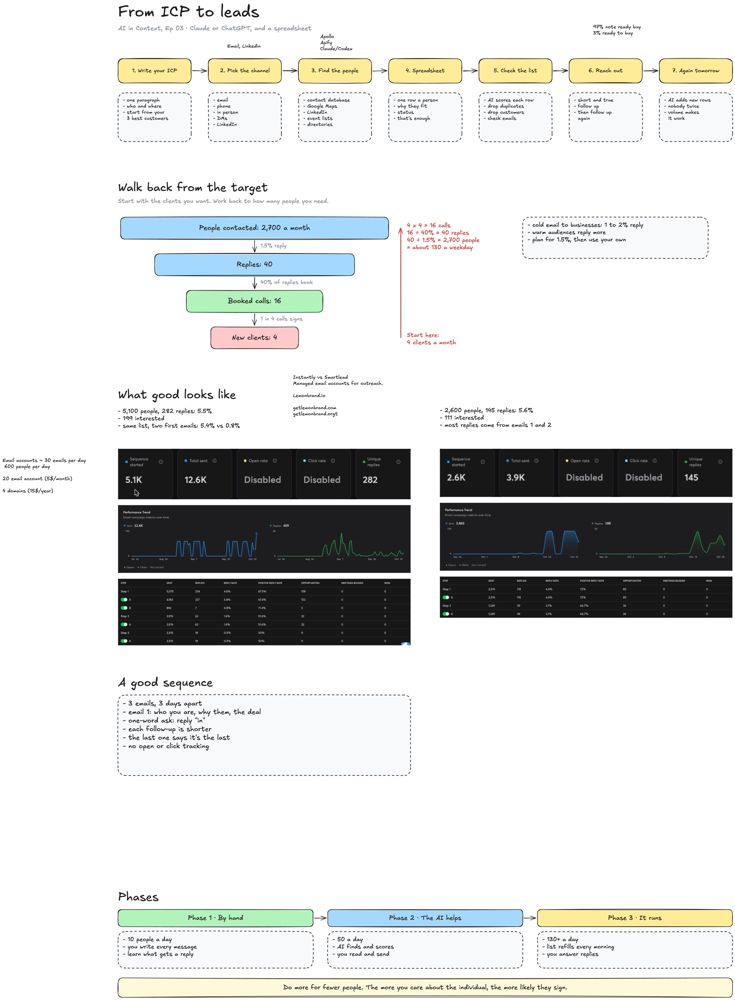

# Ep 03: Build lead lists

This folder is what I promised at the end of [AI in Context](../README.md) Ep 03, on October 22, 2026: the board, the prompt, and the step-by-step with the tools I use and what they cost. An hour wasn't enough for this one, so a video walking through it is coming too.

The short version:

> lead list building is about making it work at a small scale and then scaling it up.

Sending one email to one person is simple. It gets complicated with volume. Start with 25 people, which is a human number, not 2,500.

## What's in here

| File | What it is |
|---|---|
| [PROMPT.md](PROMPT.md) | The one prompt, plus the sample ICP from the session |
| [AGENTS.md](AGENTS.md) | Instructions for the project folder, so every chat builds the list the same way |
| [docs/images/ep03-board.jpg](docs/images/ep03-board.jpg) | The board, with the notes I added live |

To use them: make a project (Claude, ChatGPT or Codex), drop `AGENTS.md` in as the project instructions, connect your tools (below), then paste the prompt from `PROMPT.md` with your own ICP.

## The steps

1. **Write your ICP.** One paragraph: who they are, where, how big, who signs, and what's going on when they need you. Your first 10 clients may be early clients (people willing to take a chance), not your real ICP. Until you get 10 sales from outreach, the job is to sharpen the ICP. If you have call transcripts, mine them for your buyers' own words and use those in your copy.
2. **Pick the channel.** For B2B, email and LinkedIn convert best. Trades and local shops: Google Maps and the phone. People who show up to things: events. One example from a creator program: 10,000 Instagram DMs got about 0.1%. The same people on LinkedIn replied at 8%.
3. **Find the people.** A contact database, Google Maps, LinkedIn Sales Navigator, event lists (people who paid to attend are great leads), directories. Never let the agent guess an email.
4. **Put them in a spreadsheet.** One row a person, why they fit, status. Don't build a database until the spreadsheet hurts.
5. **Check the list.** Don't trust it blindly at the start. Data goes stale: a lot of the people AI finds are retired or gone. Disqualify before you go wide.
6. **Reach out.** Short and true. Personalization is mostly not worth it outside enterprise sales. Follow up, then follow up again.
7. **Do it again tomorrow.** 50 a day beats 500 once. 97% of a market isn't ready to buy at any given moment, so one sequence is not a verdict on a person.

## Walk back from the target

Start from what you can deliver, not from how many emails you can send.

| Step | Number |
|---|---|
| New clients a month | 4 |
| Booked calls (1 in 4 signs) | 16 |
| Replies (40% of replies book) | 40 |
| People contacted (1.5% reply) | about 2,700 a month, about 130 a weekday |

Plan for 1.5% and swap in your own numbers as soon as you have them. My rule: under 2% reply means the copy needs work, over 2% means do more of it. Outreach done by hand to a small group replies at 30 to 40%. Expect about two months from a booked call to money in the bank.

## Tools and what they cost

What I use: Apollo and Apify to find people, Claude or Codex to run it, and Instantly to send. My own stack runs about $150 a month. You can start for about $30 a month and send from your own email at low volume.

| Job | Tool | Cost (as of Oct 2026, check before you buy) |
|---|---|---|
| Find people (database) | Apollo | 100 free credits a month. Paid plans around $50 to $60 a month for about 2,500 credits |
| Find people (scrapers) | Apify, e.g. the Leads Finder actor | $5 of free credit a month. About $1.50 per 1,000 leads |
| Run it | Claude, ChatGPT or Codex, with the tools connected | Your existing plan |
| Enrich (more about a person you already have) | Clay | Paid |
| Send at volume | Instantly or Smartlead (managed sending accounts) | Domains about $15 a year, email accounts about $5 a month each |
| LinkedIn at volume | HeyReach | Paid. LinkedIn allows about 200 connection requests a week |

**Cheap leads aren't always cheap.** The Apify leads are about 30 times cheaper than Apollo's, but nobody cleans them. In a test we ran in May, 80% of the Apollo emails came back valid against 40% from one Apify scraper (small sample). After bounces and the damage to your sending reputation, the price gap mostly disappears. Assume half a scraped list is unusable, and test small before you scale.

**How to connect them.** Apollo has a ready-made connector in Claude and ChatGPT. Apify doesn't, so add it as a custom MCP server, or paste Apify's setup prompt into your agent and let it connect it for you. Use natural language from there instead of clicking through the tool's interface.

**Sending volume, the math.** One email account sends about 30 a day before its reputation drops. Keep about 5 accounts per domain, and never send cold email from your main domain. For 600 a day you need 20 accounts on 4 domains: about $100 a month for the accounts and $60 a year for the domains. Start with your own inbox or LinkedIn first, and only pay for this once something works.

## Good sequences

- 3 emails, up to 5. More than that is exhausting.
- Most replies come from the first, second or last email.
- One sequence per test. Skip A/B tests at the start.
- Keep the ask to one word: "Interested?"

## Phases

| Phase | Volume | What you do |
|---|---|---|
| By hand | about 10 a day | Write every message, learn what gets a reply. Start with warm contacts, referrals and people who connect you to others. Feedback before sales |
| The AI helps | about 50 a day | The agent finds and scores, you read and send |
| It runs | 130+ a day | The list refills every morning, you answer replies |

Reply rates drop when you scale. That's normal.

## Staying organized as it grows

One agent per job. One agent finds 100 new people a day and adds them to the sheet, and that's all it does. Another takes the new rows into your outreach (email, LinkedIn, one agent each). Another checks for replies and updates each person's row. Build it up one rep at a time.

Start with a thread in a project folder. When it needs to run with your laptop closed, move it to the cloud: managed agents in Claude or ChatGPT, or your own server with the Claude or Codex SDK and something to watch it (I use [Dagu](https://github.com/dagu-org/dagu)). That's a future session.

## Questions from the room

- **Buyer signals** (hiring for a role, talking about AI in public): put the signal in the ICP and ask the agent to look for it. The sample ICP does this with "they're hiring because of it".
- **Reddit** is better for broadcasting your opinions than for finding people.
- **How do I start a new venture with no conversion numbers?** Phase 1, by hand. Talk to people who connect you to others. The numbers come from there.

Replay and all sessions: https://lemonbrand.io/live
